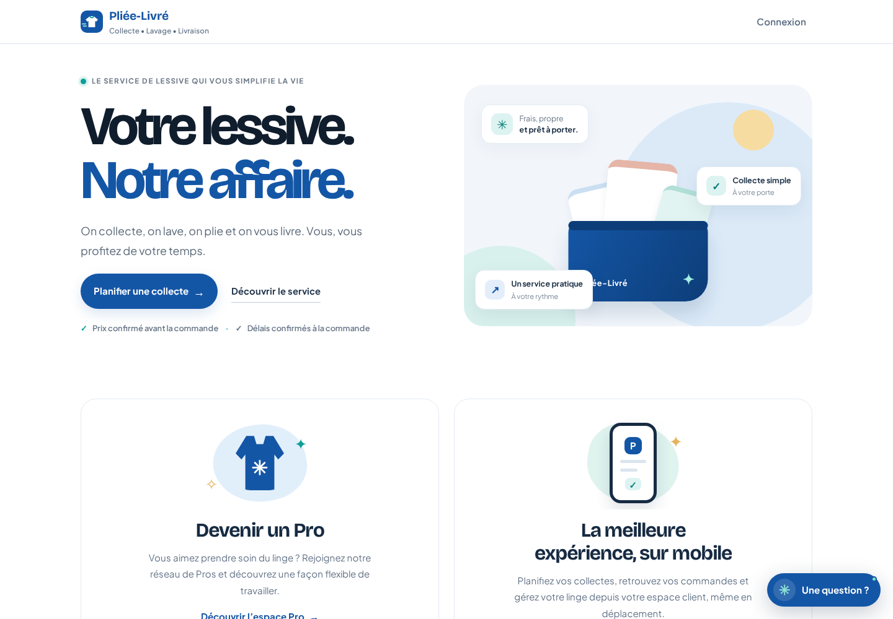

# PLIEE-LIVRE — Documentation complète A à Z

Dernière consolidation : 2026-10-28. Documentation en français du produit, de son architecture, des environnements, des rôles, des tests et des risques.

## Index
- [Architecture](docs/01-architecture.md)
- [Fonctionnalités et périmètre](docs/02-fonctionnalites.md)
- [Installation et commandes](docs/03-installation.md)
- [Supabase, migrations, Auth et RLS](docs/04-supabase-et-auth.md)
- [Déploiement Docker / Windows / WSL2](docs/05-deploiement.md)
- [Tests, preuves et critères de recette](docs/06-tests.md)
- [Sécurité et secrets](docs/07-securite.md)
- [Mobile — port 3001](docs/08-mobile.md)
- [Incidents ouverts et feuille de route](docs/09-roadmap.md)
- [Historique et décisions](docs/10-historique.md)
- [Galerie visuelle — prototype mobile et infrastructure](docs/11-galerie-prototype.md)
- [Galerie visuelle — application Web](docs/13-galerie-web.md)
- [Journaux Supabase / PostgreSQL](docs/12-supabase-logs.md)

## Application Web — aperçu

Les deux prototypes Web sont documentés séparément : [index visuel des deux prototypes Web](docs/14-galeries-des-prototypes-web.md), [galerie Next.js (port 3000)](docs/13-galerie-web.md) et [galerie du prototype mobile (port 3001)](docs/11-galerie-prototype.md). Le prototype Vite original (port 4173) est décrit à part; ses nouvelles captures directes restent à réaliser lorsque le PC Windows et le serveur seront accessibles.

> Capture réelle de `http://localhost:3000`, actualisée le 27 octobre 2026. Voir la [galerie Web complète](docs/13-galerie-web.md); la barre horizontale visible reste à corriger.

## Aperçu visuel du projet

La [galerie visuelle](docs/11-galerie-prototype.md) regroupe les parcours du prototype mobile (connexion, Client, Pro, Gestion et assistant). Les captures de l’application sont des écrans de démonstration; elles ne prouvent pas une intégration métier en production.

### Infrastructure — journaux Supabase / PostgreSQL

Capture du tableau **Logs** du projet de test `PLIEE-LIVRE-TEST`, filtré sur les événements PostgreSQL. On y voit des messages de journalisation de commandes SQL et des checkpoints. Il s’agit d’un aperçu opérationnel à un instant donné, pas d’un audit complet ni d’une preuve que chaque fonction métier fonctionne.

  

Pour le contexte et les limites d’interprétation, voir [Journaux Supabase / PostgreSQL](docs/12-supabase-logs.md). Pour les écrans du produit, voir aussi l’aperçu du [tableau de bord Gestion](docs/assets/prototype-screenshots/02-gestion-dash.png).

## État exécutif (2026-10-28)
- Application Web Next.js/React dans `/home/dina/Desktop/PLIEE-LIVRE`, port de test 3000.
- Projet Supabase de test `PLIEE-LIVRE-TEST`, région Canada Central, réf. `wbkbkygmovuvhagsuixi`. Les migrations 0001–0005 ont été appliquées selon les rapports; une inspection antérieure a compté 27 tables, 48 politiques RLS et 30 routines.
- Tests locaux documentés : 18/18 tests de domaine et 47/47 contrôles de simulation DB. Ils ne remplacent pas les tests distants.
- Auth Web : les comptes de test existent et des appels Auth directs ont réussi dans un contrôle antérieur. Le parcours complet navigateur/session/redirect n'est pas encore confirmé.
- Mobile port 3001 : prototype HTML/JS; authentification simulée, données locales, pas d'API métier confirmée.
- Storage `preuves` absent lors de la dernière inspection documentée; état à recontrôler.
- Stripe et webhooks non certifiés; paiements réels désactivés.

## Règles de preuve
« Réussi » signifie que le résultat final est capturé. Un test bloqué est non confirmé. HTTP 200 valide l'accessibilité, pas l'intégration métier. Les tests DB simulés ne prouvent pas RLS distante.

## Secrets
Ne jamais commiter `.env.local`, `.env.production`, mots de passe, clés service-role, jetons, secrets Stripe/webhook, cookies ou sauvegardes de comptes. Ce dépôt est privé et contient de la documentation seulement, pas le code source de l'application.

## Contribuer
Mettre à jour le document spécialisé et cet état exécutif; dater les changements; fournir la commande et une preuve expurgée; distinguer local, distant et E2E; ne jamais consigner de secret.
