# Galerie visuelle — prototype mobile PLIEE-LIVRE

> Captures réelles de la maquette locale, prises le 28 octobre 2026 dans Microsoft Edge en format mobile (390 × 844). Les espaces utilisent des données de démonstration : ces captures illustrent l'interface, pas une preuve d'authentification, de paiement ou de traitement en production.

## Parcours de connexion

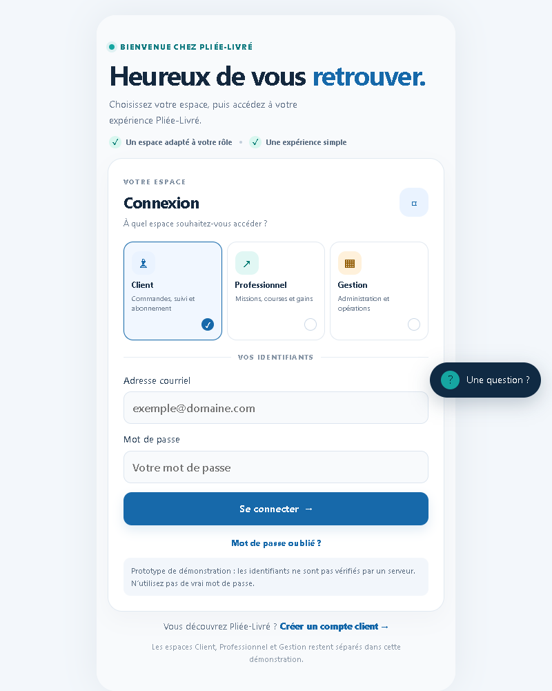

## Espace Client

| Accueil | Création de commande |
|---|---|
| 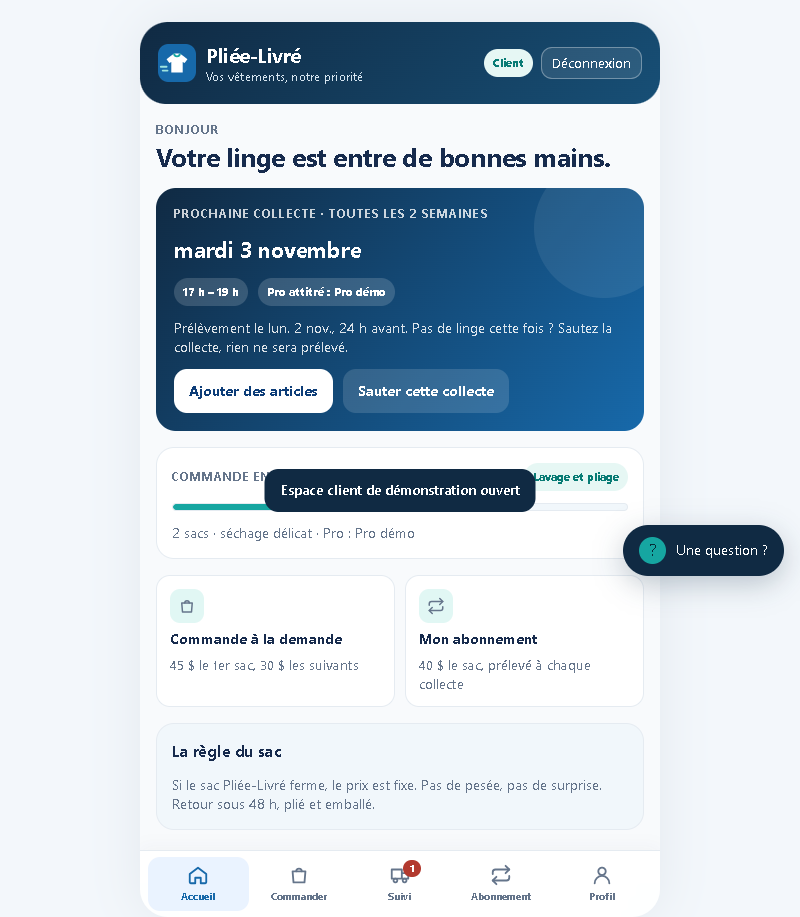 | 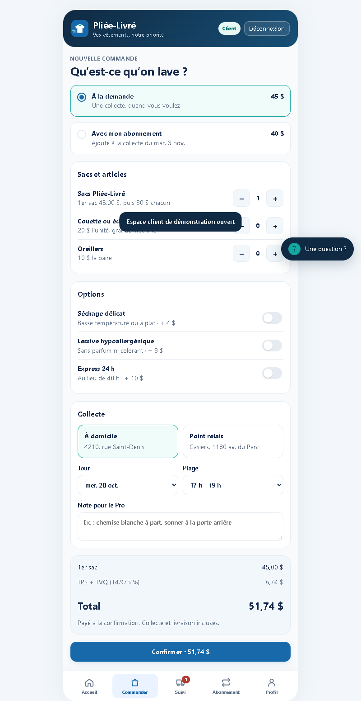 |

| Suivi de commande | Abonnement |
|---|---|
| 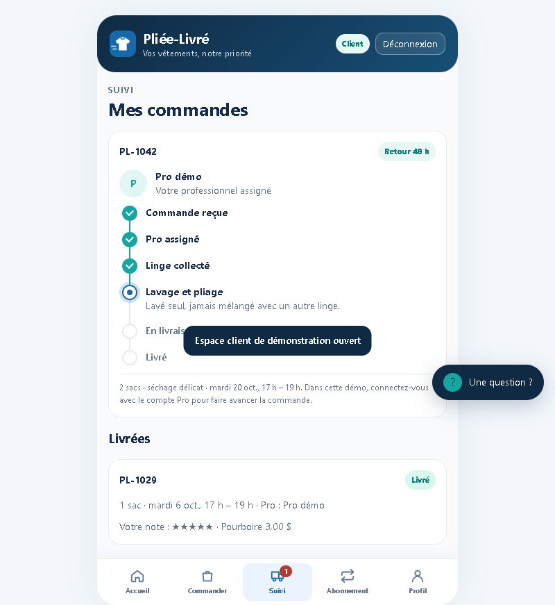 | 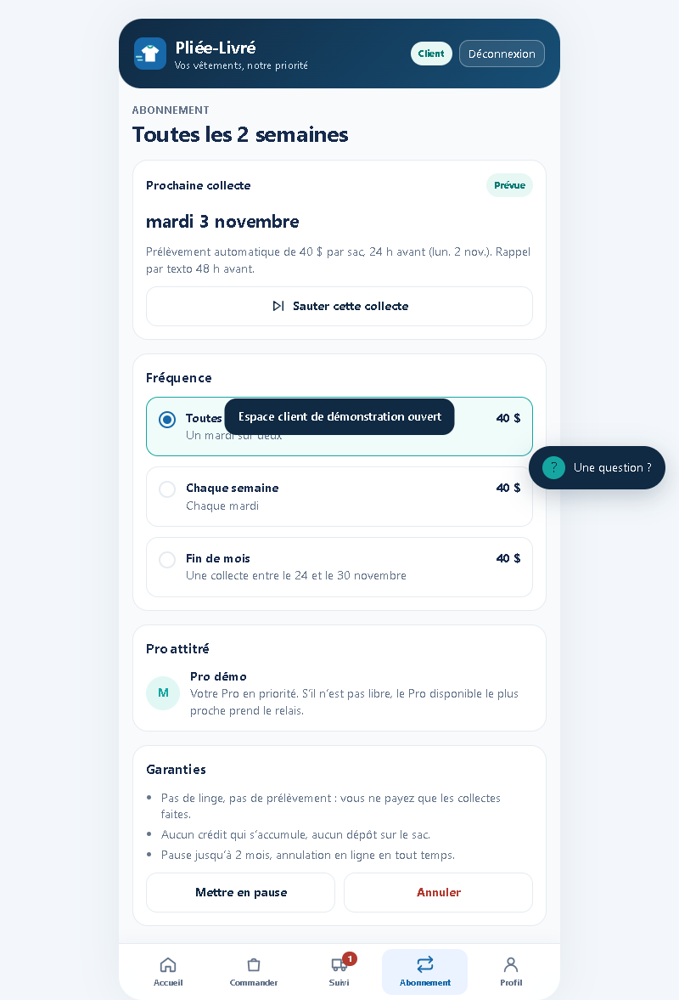 |

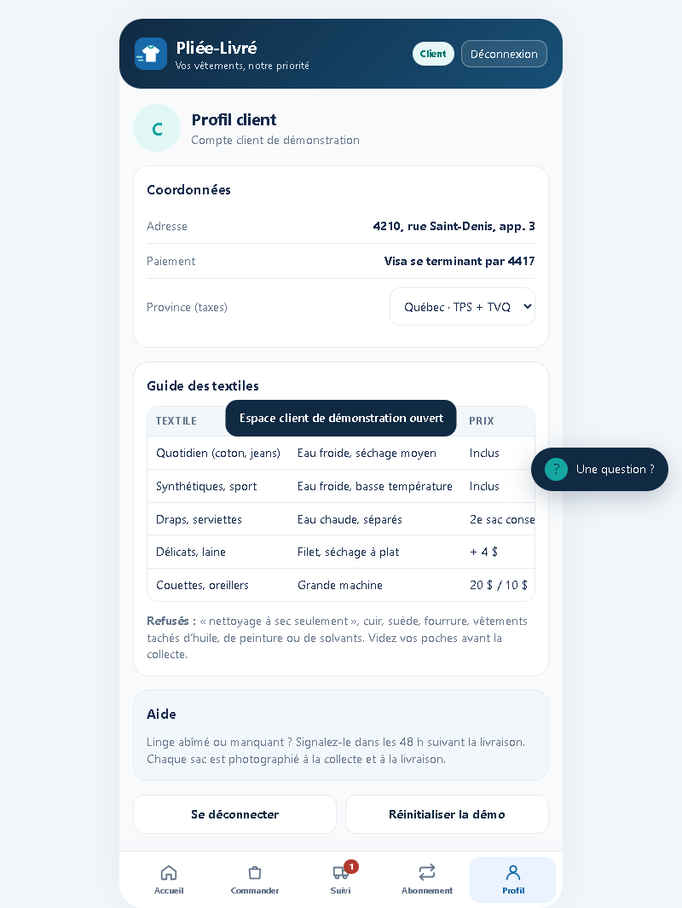

## Espace Pro

| Missions disponibles | Mes courses |
|---|---|
| 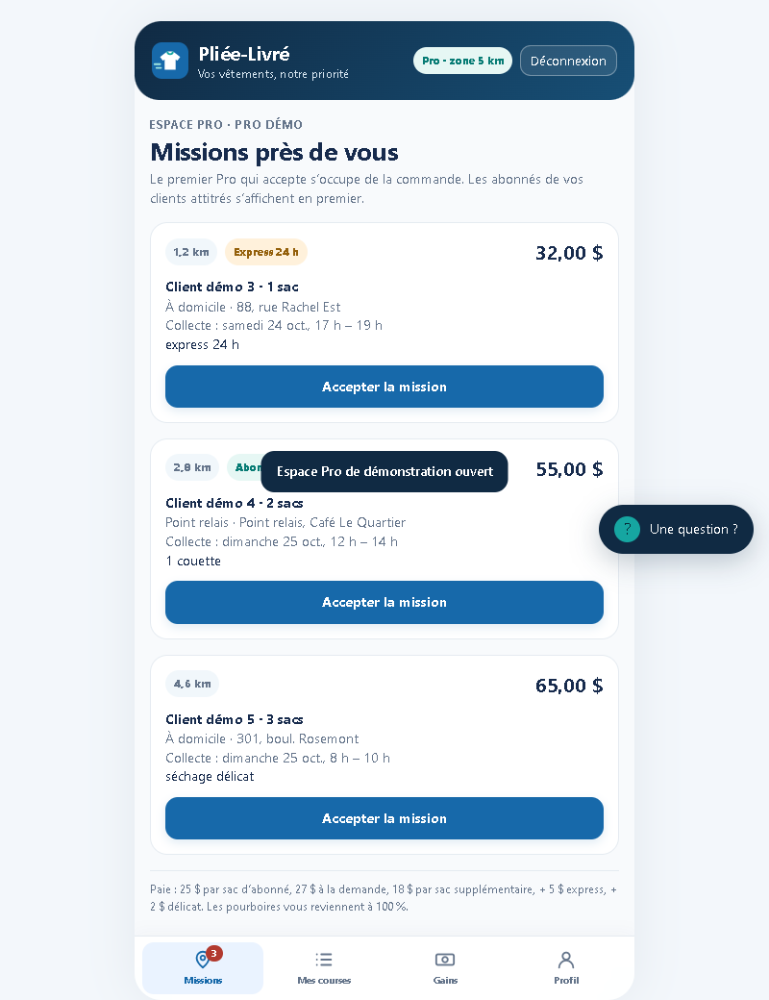 | 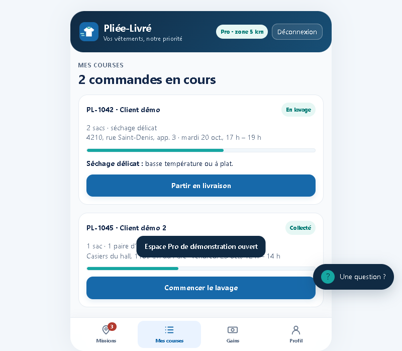 |

| Gains | Profil Pro |
|---|---|
| 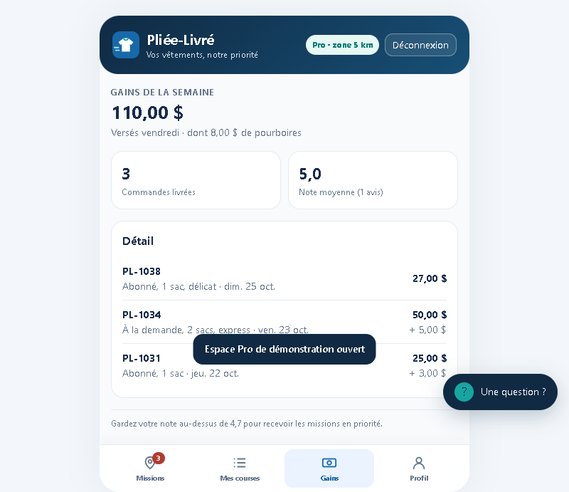 | 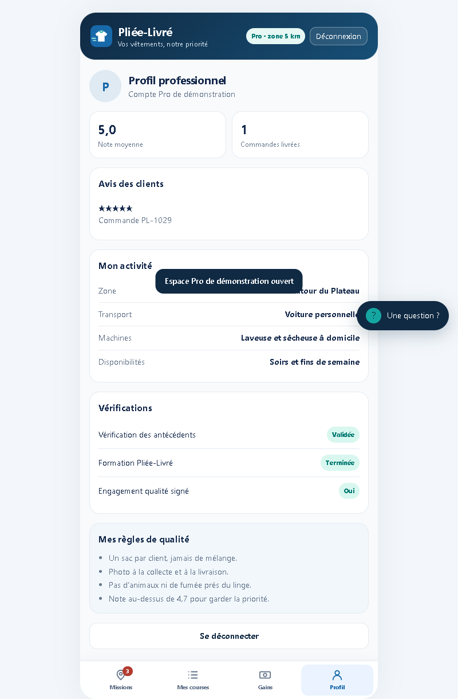 |

## Espace Gestion

| Tableau de bord | Liste prioritaire de fin de mois |
|---|---|
| 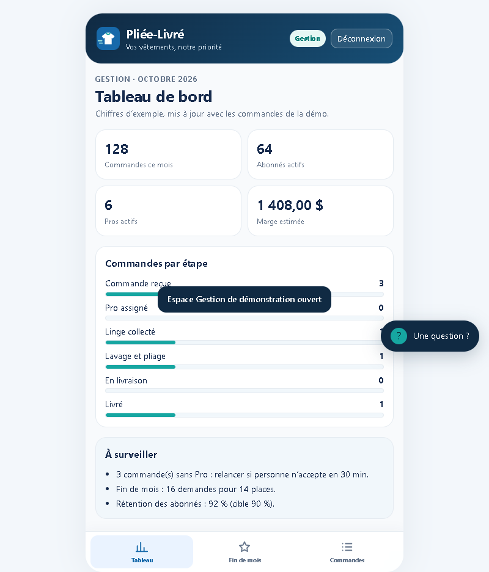 | 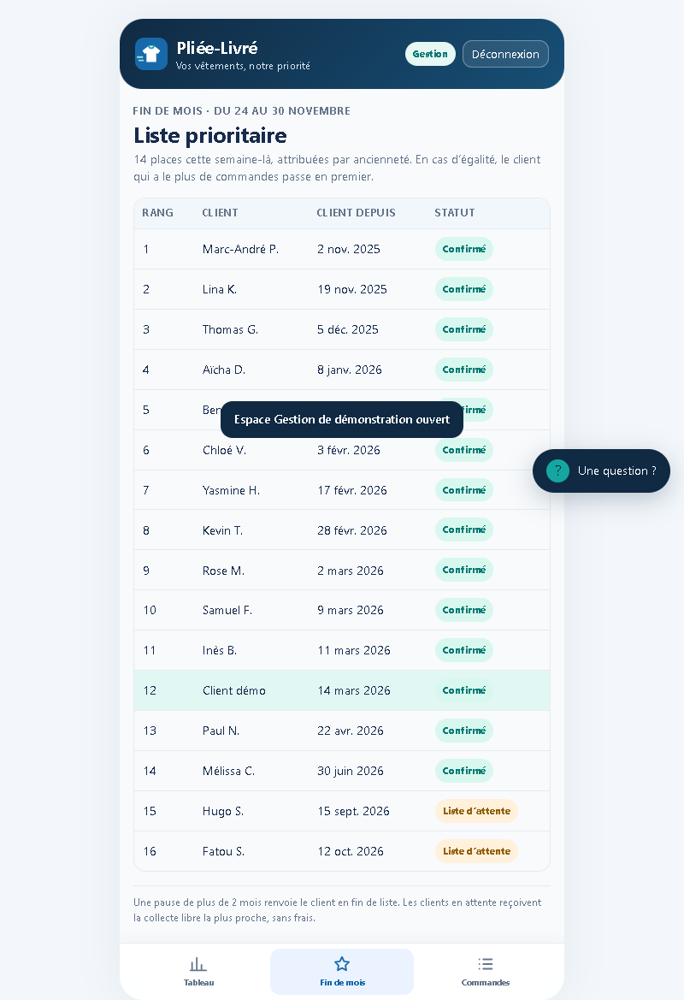 |

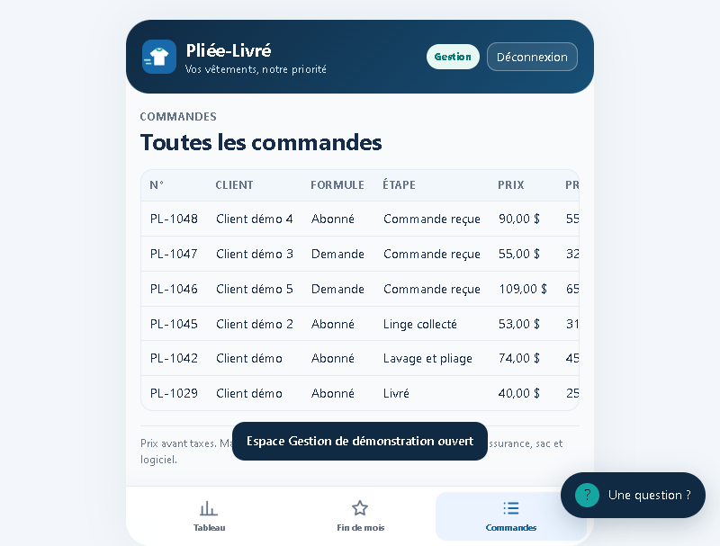

## Assistant intégré

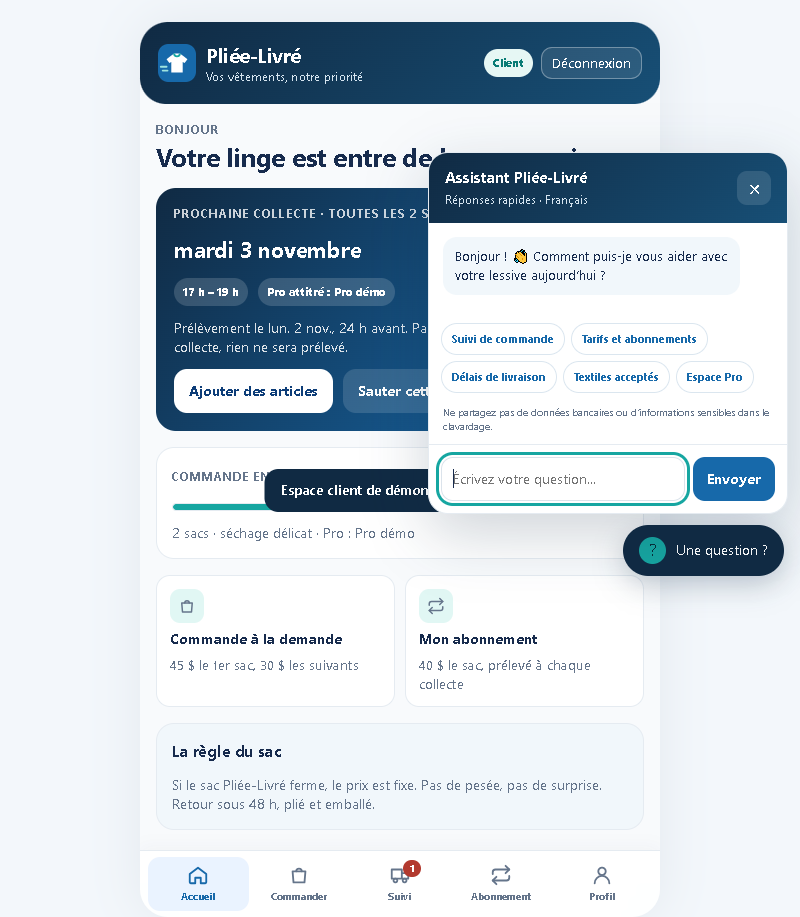

## Infrastructure — Supabase / PostgreSQL

Cette capture de la console Supabase est une preuve opérationnelle distincte des écrans du prototype mobile. Elle montre les journaux PostgreSQL du projet de test, avec des messages SQL et des checkpoints; elle ne certifie pas à elle seule la sécurité ni le bon fonctionnement de l’application.

  

Lire le [détail de la capture et ses limites](12-supabase-logs.md).

## Inventaire complet

Toutes les captures PNG sont conservées dans [`assets/prototype-screenshots/`](assets/prototype-screenshots/). L'index détaillé des fichiers se trouve dans le [README des captures](assets/prototype-screenshots/README.md). Le fichier `clipboard-capture.png` conserve également l'image qui se trouvait dans le presse-papiers lors de la capture.

## Périmètre et limites

- Les captures montrent les écrans principaux des espaces Client, Pro et Gestion, ainsi que la connexion et le chatbot.
- Les captures sont des images statiques; les interactions, états d'erreur, confirmations et toutes les fenêtres modales ne sont pas exhaustivement documentés.
- Le prototype mobile est une maquette front-end : la connexion est simulée et les données sont locales. Ne pas interpréter les données affichées comme des données de production.
