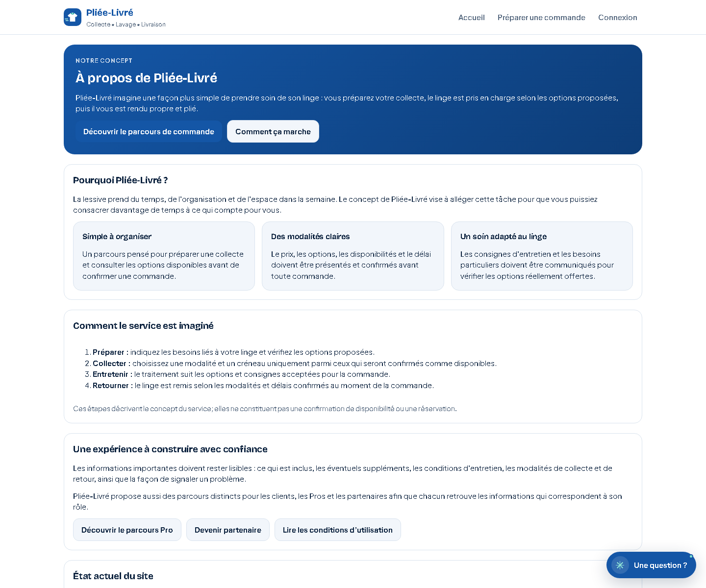
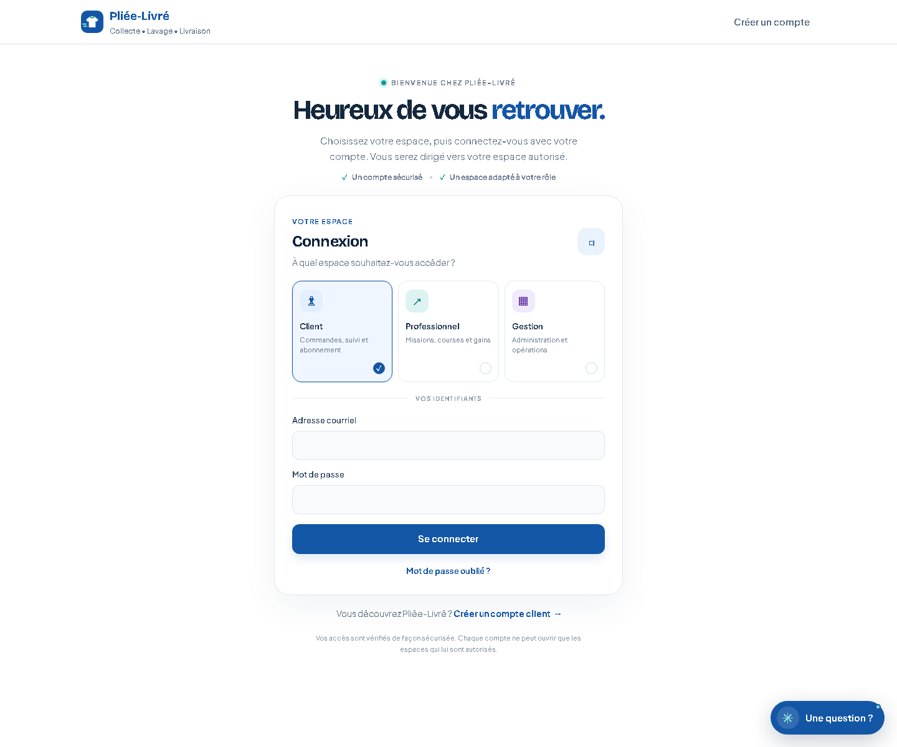
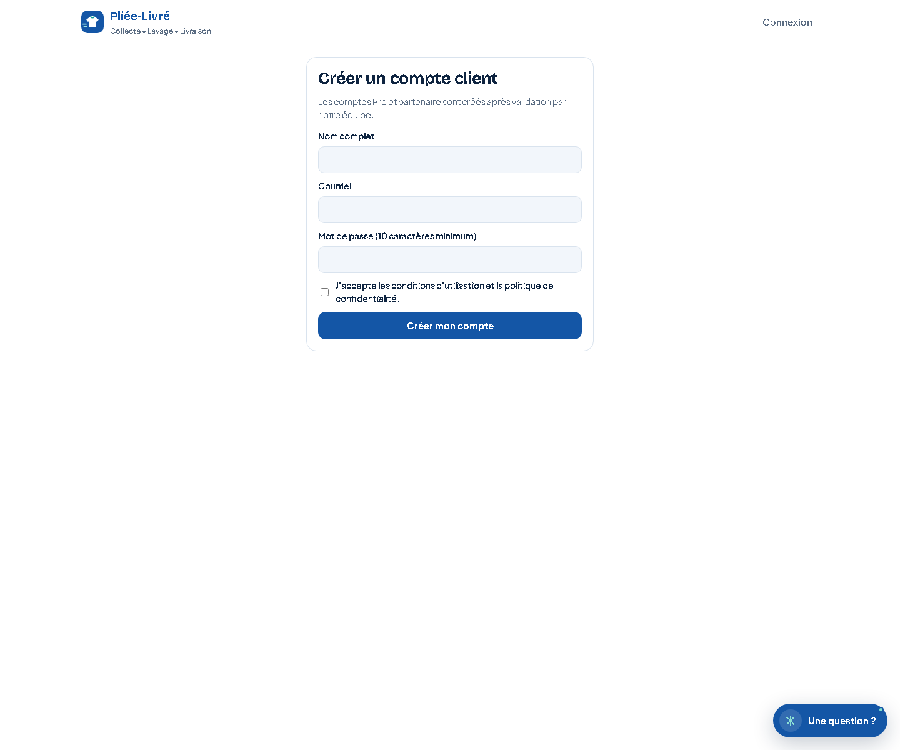
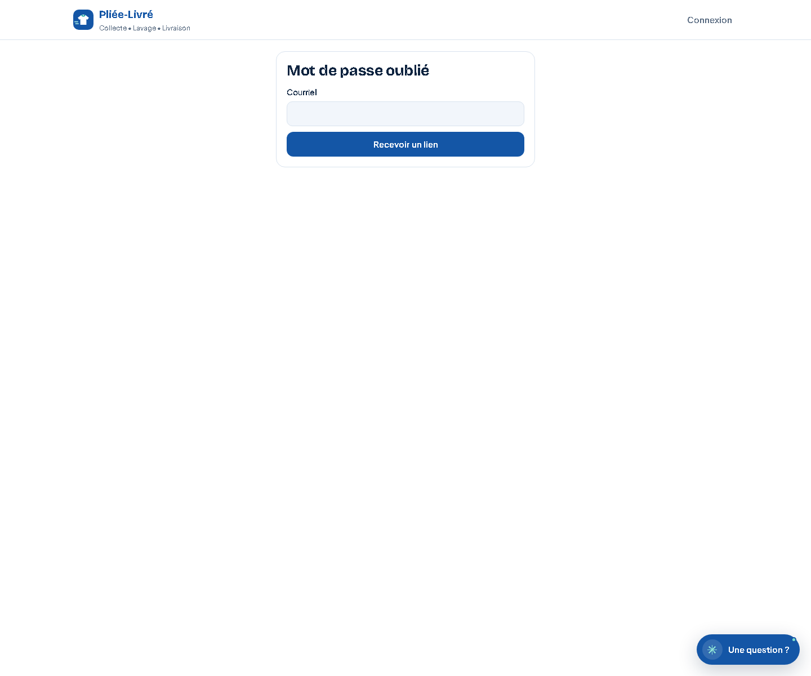
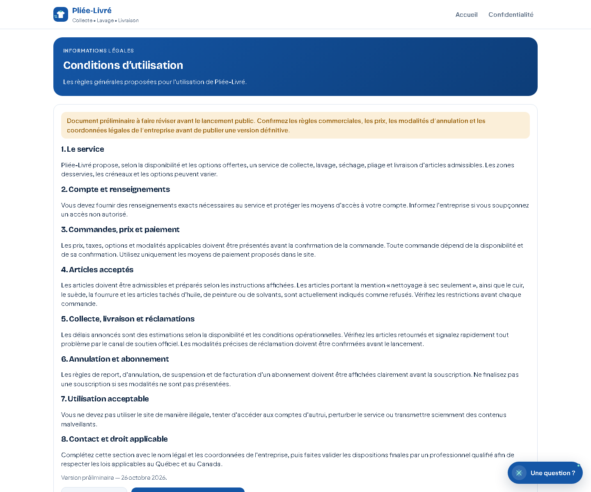
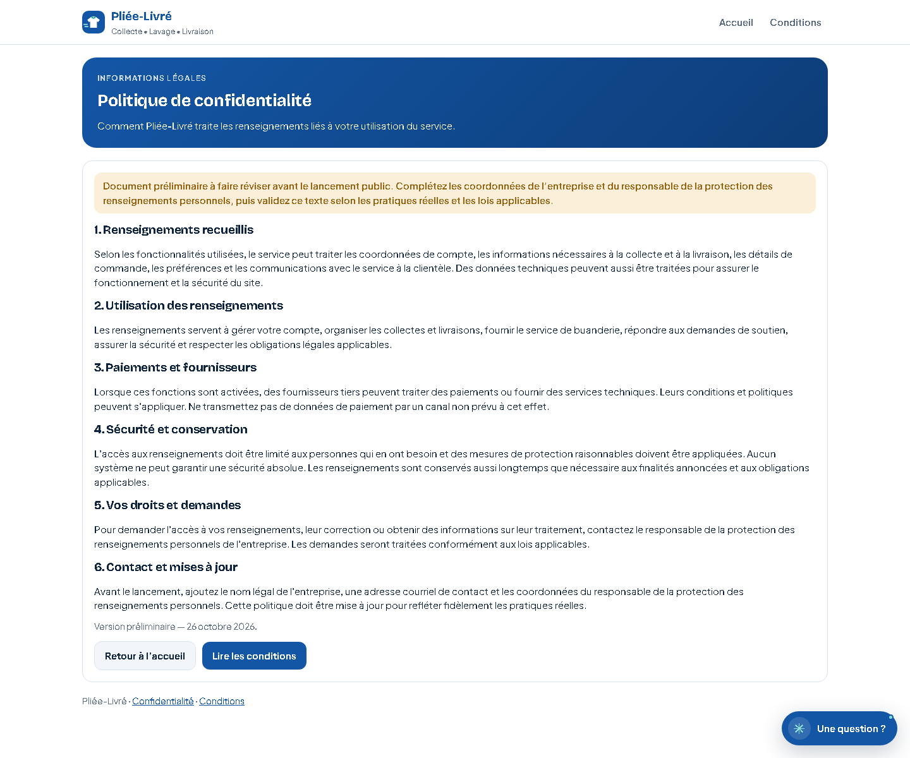
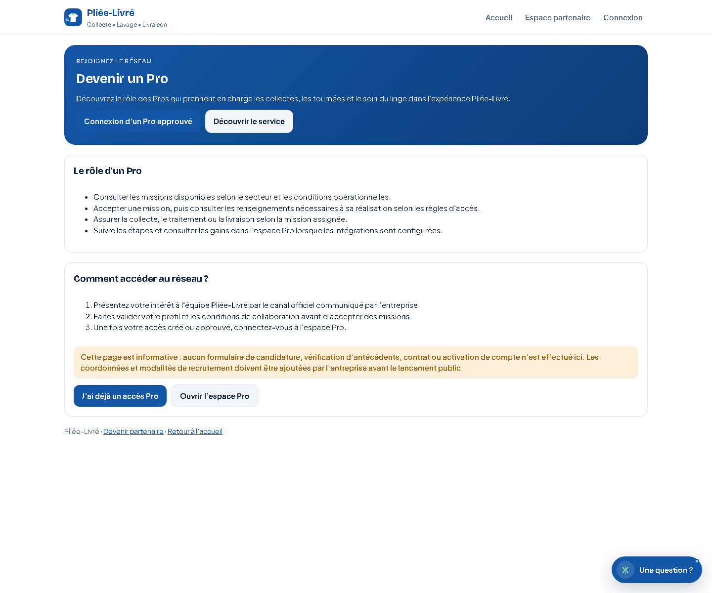
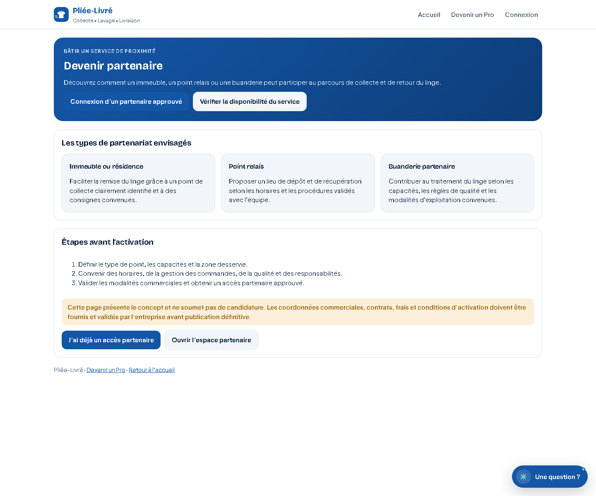
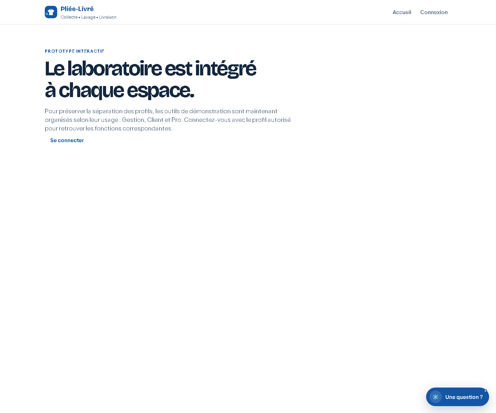

# Galerie visuelle — application Web PLIEE-LIVRE

> **Version de la galerie : 28 octobre 2026.** Captures du rendu Web local sur `http://localhost:3000`, réalisées avec Microsoft Edge. Cette galerie documente l'application Next.js Web et reste distincte du [prototype mobile](11-galerie-prototype.md), servi séparément sur le port 3001.

## Sommaire

- [Parcours public](#1-parcours-public)
- [Espace Client](#2-espace-client--session-requise)
- [Espace Pro](#3-espace-pro--session-requise)
- [Espace Gestion](#4-espace-gestion--rôle-administrateur-requis)
- [Espace Partenaire](#5-espace-partenaire--session-requise)
- [Démonstration et laboratoire](#6-démonstration-et-laboratoire)
- [Carte des routes](#7-carte-des-routes-web)
- [État de validation et limites](#8-état-de-validation)

## 1. Parcours public

### 1.1 Accueil — présenter le service

La page présente la proposition de service de collecte, d'entretien et de livraison du linge, les appels à l'action et les accès vers les autres parcours. La capture conserve le rendu tel qu'observé : une barre de défilement horizontale est visible en bas. Elle est signalée comme anomalie d'affichage, sans retouche graphique de la capture.

### 1.2 À propos — expliquer le concept

Cette page présente le concept et les étapes générales du service. Elle explique le parcours, mais ne prouve pas qu'une collecte est disponible à une adresse donnée ni qu'une réservation est confirmée.

### 1.3 Connexion

**Objectif :** permettre à un compte existant d'accéder à son espace. Le formulaire est défini par la route `/connexion`. Les droits réellement accessibles après connexion dépendent du rôle du compte et de la session; cette capture seule ne valide pas le cycle complet d'authentification.

### 1.4 Inscription

**Objectif :** proposer la création d'un compte. La route existe dans `src/app/inscription/page.tsx`. La capture documente le rendu initial, pas la création effective d'un utilisateur ni la réception d'un courriel de confirmation.

### 1.5 Mot de passe oublié

**Objectif :** lancer le parcours de récupération d'accès. La route est `/connexion/mot-de-passe-oublie`; la page de définition d'un nouveau mot de passe existe séparément à `/connexion/nouveau-mot-de-passe`. L'envoi effectif du courriel et la validation du lien nécessitent un test de bout en bout distinct.

### 1.6 Conditions du service

Cette page est accessible à `/conditions`. Elle fournit le contexte contractuel du service. Sa présence dans la galerie ne remplace pas une revue juridique ni un test de liens depuis l'inscription ou la commande.

### 1.7 Confidentialité

Cette page est accessible à `/confidentialite`. Elle est documentée séparément des conditions. Une capture visuelle ne constitue pas un audit de la collecte, du stockage ou de la suppression effective des données.

### 1.8 Devenir Pro

**Objectif :** présenter le parcours d'intérêt ou d'adhésion des professionnels. La route publique a été repérée dans la version inspectée. Les captures de formulaire ne démontrent pas qu'une demande est enregistrée ou qu'un compte Pro est activé.

### 1.9 Devenir partenaire

**Objectif :** présenter le parcours partenaire. Le tableau de bord partenaire authentifié est distinct de cette page publique et décrit à la section 5.

## 2. Espace Client — session requise

Les pages Client utilisent `requireRole(["client"])` sur les pages qui l'exigent. Pour les inspecter en situation réelle, se connecter avec un compte de test autorisé. Les descriptions ci-dessous sont établies à partir des fichiers de route; elles ne sont pas des captures authentifiées.

### 2.1 Tableau de bord — `/client`

- Accueil personnalisé avec salutation.
- Si un abonnement existe : fréquence, prochaine collecte ou état de pause et lien pour gérer l'abonnement.
- Sinon : actions pour commencer une commande ou s'abonner.
- Zone de notifications et tableau des commandes récentes avec numéro, collecte, étape et total.
- Les données sont chargées depuis Supabase; leur présence dépend du compte et des données disponibles.

### 2.2 Nouvelle commande — `/client/commander`

Le formulaire `OrderForm` reçoit les règles de tarification, les adresses en zone desservie, les points relais actifs et l'information d'abonnement. Si aucune adresse desservie ni aucun point relais n'est disponible, la page invite à ajouter une adresse au profil. Le parcours doit être testé avec un compte de test et une configuration de données contrôlée.

### 2.3 Détail et suivi d'une commande — `/client/commandes/[id]`

La page de détail est dynamique et identifiée par l'ID de commande. Elle doit être vérifiée avec une commande de test appartenant au client connecté. Ne pas utiliser une vraie adresse ou des renseignements personnels dans les captures destinées au dépôt.

### 2.4 Abonnement — `/client/abonnement`

- Création d'abonnement si aucun abonnement actif n'est trouvé.
- Fréquence (hebdomadaire, toutes les deux semaines ou fin de mois), première collecte, plage horaire, adresse et nombre de sacs.
- Pour un abonnement existant : prochaines collectes, action de sauter/rétablir une collecte, modification de fréquence, pause/reprise et annulation.
- Le texte de l'interface précise les limites de configuration du paiement. Ne pas présenter le prélèvement comme fonctionnel sans test avec un fournisseur activé.

### 2.5 Profil et adresses — `/client/profil`

Espace de gestion du profil et des adresses, notamment utile lorsque la commande exige une adresse située dans une zone desservie. Tester l'ajout, la modification et la validation d'une adresse avec des données fictives.

### 2.6 Notifications — `/client/notifications`

Historique des notifications liées au compte et aux commandes. La page doit être inspectée avec un compte possédant des événements de test; une liste vide n'indique pas à elle seule une panne.

## 3. Espace Pro — session requise

### 3.1 Missions disponibles — `/pro`

Le tableau présente les missions disponibles, secteur, canal de collecte, sacs, options, créneau et rémunération prévue. L'action « Accepter la mission » affecte la mission au premier Pro qui l'accepte selon la logique décrite dans l'interface. L'adresse complète n'est annoncée qu'après acceptation.

### 3.2 Mes courses — `/pro/courses`

- Commandes attribuées au Pro et qui ne sont pas terminées ou annulées.
- Étape de commande et actions permises pour passer à l'étape suivante.
- Photo obligatoire pour confirmer certaines étapes de collecte/livraison.
- Messages limités à la commande et à ses deux participants.
- Saisie du temps, enregistrement des cycles de lavage/séchage et signalement d'incident.
- Libération d'une mission lorsque cette action est permise.

Les captures de cet espace doivent utiliser des commandes de test et masquer les coordonnées, noms et messages personnels.

### 3.3 Gains — `/pro/gains`

Route de consultation des gains du Pro. Le montant affiché doit être comparé à des commandes de test et aux règles de calcul applicables; une capture ne constitue pas une validation comptable.

### 3.4 Profil Pro — `/pro/profil`

Route dédiée au profil professionnel. Les champs exacts et les actions doivent être documentés après inspection visuelle authentifiée.

## 4. Espace Gestion — rôle administrateur requis

Les routes Gestion vérifient le rôle `admin`. L'absence de session autorisée doit mener au refus ou à la redirection prévue; ne pas contourner ces contrôles pour produire des captures.

### 4.1 Tableau de bord — `/gestion`

- Résumé des commandes des 30 derniers jours par statut.
- Alerte pour les commandes en attente d'affectation depuis plus de 30 minutes.
- Incidents non résolus.
- État descriptif des intégrations.

### 4.2 Commandes — `/gestion/commandes`

Liste et suivi des commandes, filtres par statut et possibilité d'affecter manuellement les commandes en attente lorsque nécessaire. Les actions disponibles et leurs résultats doivent être vérifiés avec des commandes de test.

### 4.3 Professionnels — `/gestion/pros`

Espace de gestion des professionnels. La capture future doit montrer les actions réellement disponibles et ne doit contenir ni secrets ni données personnelles réelles.

### 4.4 Tarifs — `/gestion/tarifs`

Interface de gestion des règles tarifaires. Documenter séparément les valeurs affichées, les validations et leur persistance; ne pas modifier les tarifs de production pendant la prise de captures.

### 4.5 Finances — `/gestion/finances`

Vue financière interne. Les montants affichés doivent être issus de données de démonstration ou expurgés avant toute publication.

### 4.6 Fin de mois — `/gestion/fin-de-mois`

Vue de suivi de l'allocation de fin de mois et de la priorité liée à l'ancienneté. Les règles de classement doivent être validées à l'aide des tests métier, pas seulement par l'apparence de la page.

### 4.7 Applications — `/gestion/applications`

Route de gestion des demandes ou applications. La vue et les actions doivent être capturées après authentification admin et test sur données fictives.

### 4.8 Laboratoire de démonstration — `/gestion/laboratoire`

Le laboratoire interne utilise le composant `PrototypeDemoLab`. Son texte précise qu'il présente des données fictives et ne modifie aucune commande réelle. Il est distinct de la page de démonstration publique `/demo`. Cette route est protégée par le rôle administrateur.

## 5. Espace Partenaire — session requise

### 5.1 Tableau de bord partenaire — `/partenaire`

La page affiche les informations du partenaire, ses paramètres de type d'activité et d'utilisation des machines, puis les commandes liées aux points partenaires. Les actions d'avancement dépendent du statut de commande. L'interface précise que les coordonnées des clients ne sont pas visibles dans cet espace.

### 5.2 Redevances — `/partenaire/redevances`

Route dédiée aux redevances. Les montants et règles doivent être confirmés sur un jeu de test avant d'utiliser des captures pour communiquer une valeur contractuelle.

## 6. Démonstration et laboratoire

### 6.1 Laboratoire public — `/demo`

La page introduit un prototype interactif inspiré de la maquette Vite. Le composant `PrototypeDemoLab` présente des parcours de démonstration autour des communications, factures, entretien textile, notifications, accès et atelier. Le texte de la page avertit que les interactions sont locales et que les données ne remplacent pas les intégrations de production.

### 6.2 Laboratoire interne — `/gestion/laboratoire`

Même composant de démonstration, mais placé dans l'espace Gestion et protégé par le rôle administrateur. L'accès doit être validé avec une session admin de test; il ne faut pas confondre ce laboratoire avec les données réelles des commandes.

## 7. Carte des routes Web

| Espace | Route | Authentification / note |
|---|---|---|
| Public | `/` | Accueil |
| Public | `/a-propos` | Concept du service |
| Public | `/connexion` | Connexion |
| Public | `/inscription` | Inscription |
| Public | `/connexion/mot-de-passe-oublie` | Récupération d'accès |
| Public | `/connexion/nouveau-mot-de-passe` | Définir un nouveau mot de passe |
| Public | `/conditions` | Conditions du service |
| Public | `/confidentialite` | Confidentialité |
| Public | `/devenir-pro` | Présentation du parcours Pro |
| Public | `/devenir-partenaire` | Présentation du parcours partenaire |
| Public | `/demo` | Laboratoire public de démonstration |
| Client | `/client` | Tableau de bord, rôle client |
| Client | `/client/commander` | Formulaire de commande |
| Client | `/client/commandes/[id]` | Détail d'une commande |
| Client | `/client/abonnement` | Gestion d'abonnement |
| Client | `/client/profil` | Profil et adresses |
| Client | `/client/notifications` | Notifications |
| Pro | `/pro` | Missions disponibles |
| Pro | `/pro/courses` | Courses attribuées |
| Pro | `/pro/gains` | Gains |
| Pro | `/pro/profil` | Profil professionnel |
| Gestion | `/gestion` | Tableau de bord admin |
| Gestion | `/gestion/commandes` | Commandes |
| Gestion | `/gestion/pros` | Professionnels |
| Gestion | `/gestion/tarifs` | Tarification |
| Gestion | `/gestion/finances` | Finances |
| Gestion | `/gestion/fin-de-mois` | Allocation de fin de mois |
| Gestion | `/gestion/applications` | Applications |
| Gestion | `/gestion/laboratoire` | Laboratoire interne, rôle admin |
| Partenaire | `/partenaire` | Commandes liées aux points partenaires |
| Partenaire | `/partenaire/redevances` | Redevances |

## 8. État de validation

### Captures incluses dans cette version

Les captures du parcours public (accueil, À propos, connexion, inscription, récupération d'accès, conditions, confidentialité, laboratoire public, Devenir Pro et Devenir partenaire) ont été produites depuis le navigateur local. Elles documentent l'apparence au moment de la capture; elles ne certifient pas les actions serveur.

### Captures authentifiées encore à réaliser

Les espaces Client, Pro, Gestion et Partenaire doivent être capturés avec des sessions de test autorisées. Pour chaque espace, compléter au minimum le tableau de bord et les pages métier principales. Utiliser des données fictives, vérifier que la capture n'est ni blanche ni redirigée, et consigner la date ainsi que le compte/ rôle de test sans exposer d'identifiant secret.

### Ce que les images ne prouvent pas

- La présence d'une page ne valide pas ses actions serveur ni sa persistance dans Supabase.
- Un rendu de formulaire ne prouve pas qu'un courriel a été envoyé, qu'un paiement a été effectué ou qu'un utilisateur a été créé.
- Les captures n'attestent pas que les règles RLS, les autorisations ou les webhooks sont sûrs.
- Les environnements de test et de production doivent être distingués.

Voir aussi : [galerie du prototype mobile](11-galerie-prototype.md), [journaux Supabase / PostgreSQL](12-supabase-logs.md), [règles de preuve](../README.md#règles-de-preuve).
