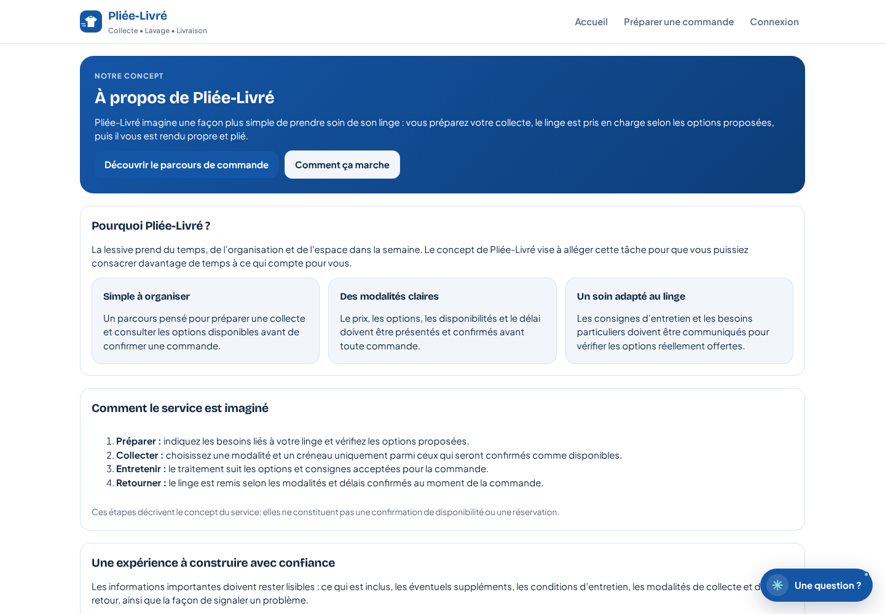

# Galerie visuelle — application Web PLIEE-LIVRE

> Captures de l’application Web locale, servie sur le port 3000, à une fenêtre de bureau de 1440 × 1000. Cette galerie est distincte du [prototype mobile](11-galerie-prototype.md), servi séparément sur le port 3001.

## 1. Accueil — proposition de service

La page d’accueil présente le service de collecte, lavage et livraison, l’action pour planifier une collecte, ainsi que les entrées vers les espaces Pro et mobile. La capture montre le rendu de la page au moment de l’inspection.

## 2. À propos — concept et étapes du service

Cette page explique le concept et présente le parcours général : préparer, collecter, entretenir et retourner le linge. Le texte précise que ces étapes décrivent le concept et ne constituent pas une confirmation de disponibilité ou une réservation.

## 3. Pages et fonctionnalités Web repérées dans le code

Les routes ci-dessous existent dans l’application; elles sont listées pour guider la navigation, mais ne sont pas illustrées tant qu’une capture visuelle valide n’a pas pu être obtenue.

| Fonctionnalité | Route | État de la capture |
|---|---|---|
| Connexion | [`/connexion`](http://localhost:3000/connexion) | Capture non validée : le navigateur headless a rendu une image blanche; elle est volontairement exclue. |
| Inscription | [`/inscription`](http://localhost:3000/inscription) | Capture non validée. |
| Préparer une commande | [`/commande`](http://localhost:3000/commande) | Capture non validée. |
| Abonnements | [`/abonnement`](http://localhost:3000/abonnement) | Capture non validée. |
| Devenir Pro | [`/devenir-pro`](http://localhost:3000/devenir-pro) | Capture non validée. |
| Devenir partenaire | [`/devenir-partenaire`](http://localhost:3000/devenir-partenaire) | Capture non validée. |
| Démonstration publique | [`/demo`](http://localhost:3000/demo) | Capture non validée. |
| Espace Client | `/client` | Connexion requise. |
| Espace Pro | `/pro` | Connexion requise. |
| Gestion | `/gestion` | Connexion requise. |
| Laboratoire de démonstration en Gestion | `/gestion/laboratoire` | Redirection HTTP 307 observée sans session. |

> Les liens `localhost` s’ouvrent uniquement sur une machine où l’application Web tourne localement sur le port 3000. Les routes protégées nécessitent une session autorisée; aucune capture n’est présentée comme une vue authentifiée sans l’avoir vérifiée.

## 4. Limites et prochaines captures

- Les deux images ci-dessus sont des captures réelles du rendu du site; aucune capture blanche ou générée artificiellement n’est incluse.
- Les tentatives automatisées pour les autres routes n’ont pas produit de captures fiables dans l’environnement de navigateur headless. Elles sont donc marquées comme non validées, plutôt que remplacées par des images fictives.
- Pour compléter cette galerie au niveau de la galerie mobile, il reste à capturer les pages publiques (connexion, inscription, commande, abonnement, espace Pro et partenaire) puis les tableaux de bord Client, Pro et Gestion au moyen d’une session de test autorisée.
- Les captures décrivent l’interface; elles ne prouvent pas le fonctionnement complet des parcours, des autorisations, de Supabase ou des paiements.

Voir aussi : [galerie mobile](11-galerie-prototype.md), [journaux Supabase / PostgreSQL](12-supabase-logs.md), [règles de preuve](../README.md#règles-de-preuve).
